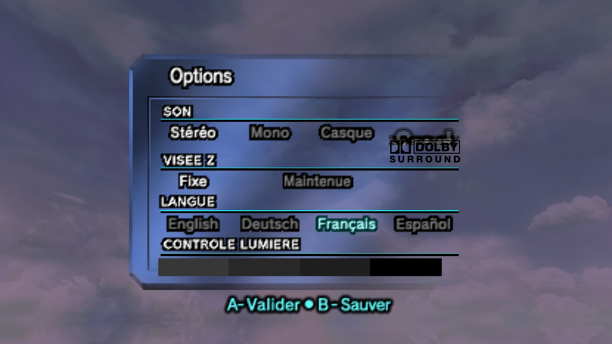
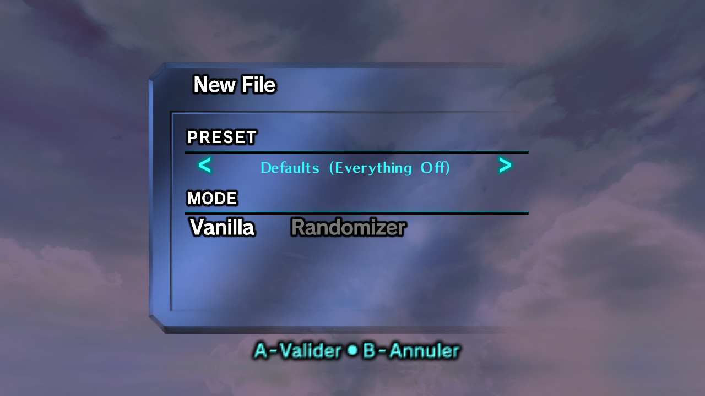

# 2 Ship 2 Harkinian – Switch PAL

[English](README.md) · [Français](README.fr.md) · [Deutsch](README.de.md) · **Español**

[](https://github.com/Desperadas-G/2ship2harkinian-Switch-PAL/actions/workflows/switch.yml)

Un port no oficial para Nintendo Switch de [2 Ship 2 Harkinian](https://github.com/2ship2harkinian/2ship2harkinian) (2S2H) que además funciona con la **versión europea (PAL 1.1) de *The Legend of Zelda: Majora's Mask***, con sus cuatro idiomas: **inglés, francés, alemán y español**.

Funciona como homebrew en una Switch con el custom firmware [Atmosphère](https://github.com/Atmosphere-NX/Atmosphere).

> Este proyecto no está afiliado a Nintendo, a HarbourMasters ni al equipo de 2Ship. Por favor, no pidas ayuda sobre este fork en el Discord oficial de 2Ship. Usa en su lugar las [issues](../../issues) de este repositorio.

## ⚖️ Aviso legal

- **Este repositorio no contiene ninguna ROM ni datos de Nintendo**, y sus releases nunca los contendrán. Solo contiene código fuente, que no es una copia del juego: el código del juego fue descompilado y reescrito en C por el proyecto [zeldaret/mm](https://github.com/zeldaret/mm).
- **Debes tener una copia legítima de *The Legend of Zelda: Majora's Mask*** y volcarla **desde tu propio cartucho** (o desde tu propio disco de GameCube para la versión US GC). Los datos del juego (`mm.o2r`) se generan en tu propio ordenador, a partir de tu volcado.
- **No pidas ROMs, y nunca compartas ROMs ni archivos `mm.o2r`**, ni aquí ni en ningún otro sitio. Las issues, pull requests o comentarios que enlacen a ROMs o las pidan se cerrarán y se borrarán.
- Descargar la ROM de un juego que no posees es piratería e ilegal en la mayoría de países. No apoyamos la piratería.
- Este es un proyecto de fans sin ánimo de lucro. No está afiliado a Nintendo, ni aprobado ni patrocinado por Nintendo. *The Legend of Zelda* y *Majora's Mask* son marcas registradas de Nintendo.

## Basado en

| Componente | Versión |
|---|---|
| 2 Ship 2 Harkinian | **5.0.1 «Battler Bravo»** |
| Port para Switch | [starshopper612/2ship2harkinian-Switch](https://github.com/starshopper612/2ship2harkinian-Switch) `switch-5.0.1-v3` (giroscopio y vibración) |
| Soporte PAL 1.1 | [2ship2harkinian#1966](https://github.com/2ship2harkinian/2ship2harkinian/pull/1966) de alexbcz ([alexbcz/2ship2harkinian-PAL](https://github.com/alexbcz/2ship2harkinian-PAL)) |

## ROMs compatibles

2Ship **no** incluye ningún contenido protegido por derechos de autor. Debes volcar tu propio cartucho.

| Versión | Compatible | CRC de cabecera | SHA-1 (`.z64`) |
|---|---|---|---|
| **PAL 1.1 / Rev A** (Europa, En/Fr/De/Es) | ✅ | `0A5D8F83` | `bb4e4757d10727c7584c59c1f2e5f44196e9c293` |
| NTSC-U 1.0 (EE. UU.) | ✅ | `5354631C` | `d6133ace5afaa0882cf214cf88daba39e266c078` |
| NTSC-U GameCube (Collector's Edition) | ✅ | `B443EB08` | `9743aa026e9269b339eb0e3044cd5830a440c1fd` |
| PAL 1.0 (primera versión europea) | ❌ | `E97955C6` | – |
| Versiones japonesas, GameCube PAL, *Majora's Mask 3D* | ❌ | – | – |

Los cartuchos PAL 1.0 y 1.1 son iguales por fuera. Se distinguen por el CRC de cabecera (bytes `0x10` a `0x13` de un volcado `.z64`), que el generador de Windows y `tools/generate-o2r.sh` comprueban por ti. Los volcados con el orden de bytes invertido (`.v64`, `.n64`) se convierten automáticamente.

Las ROMs modificadas o traducidas (traducciones de fans, hacks) no son compatibles.

## Instalación

### 1. Descargar los archivos

**En Windows**, descarga `2Ship-Switch-PAL-vX.Y.Z-windows.zip` desde [Releases](../../releases) y descomprímelo. Contiene los archivos de Switch y un generador de `mm.o2r` listo para usar: no hay que instalar nada.

En otros sistemas, descarga `2ship.nro` y `2ship.o2r` desde [Releases](../../releases), o [compílalos tú mismo](docs/BUILDING_SWITCH.md).

### 2. Generar `mm.o2r` a partir de tu ROM

`mm.o2r` contiene los datos del juego, extraídos de tu ROM.

**Windows:** arrastra tu ROM (`.z64`, `.n64`, `.v64`, o el `.zip` que la contiene) sobre **`Generate mm.o2r.bat`**. En alrededor de un minuto se crea `switch\2s2h\mm.o2r`: copia toda la carpeta `switch` a la raíz de tu tarjeta SD y pasa al paso 4.

**Linux o WSL:**

```bash
git clone <este repositorio>
cd 2ship2harkinian-Switch-PAL
tools/generate-o2r.sh /ruta/a/tu/rom.z64
```

Instala primero las dependencias. Están en [docs/BUILDING_SWITCH.md](docs/BUILDING_SWITCH.md#1-host-dependencies).

`mm.o2r` debe generarse con la **misma versión** de este repositorio que el `2ship.nro` que uses. Nunca compartas tu `mm.o2r`: contiene los datos del juego, protegidos por derechos de autor.

### 3. Copiar a la tarjeta SD

```
sdmc:/switch/2s2h/
├── 2ship.nro
├── 2ship.o2r
└── mm.o2r
```

### 4. Iniciar

Abre el Homebrew Menu **manteniendo pulsado R al iniciar un juego** (title override). No lo abras desde el Álbum: en modo applet no hay memoria suficiente y el juego se cierra o no llega a arrancar.

### 5. Elegir el idioma (solo PAL)

Elige el idioma en las opciones del juego. La elección se guarda.



_La pantalla de opciones PAL en Switch (con francés seleccionado)._

## Controles

- **Menos (−)** abre el menú de 2Ship (mejoras, trucos, ajustes).
- **El apuntado con giroscopio** y **la vibración** funcionan con los Joy-Con, el Pro Controller y los mandos de terceros compatibles. Puedes elegir la fuente del giroscopio (Joy-Con izquierdo, derecho o ambos) en los ajustes del mando.

Al crear una partida, 2Ship 5.x te pide elegir **Vanilla** o **Randomizer** y después un preset de opciones (*None*, *Curated*, *Defaults*, *Voyage 3*). Para jugar como en el original, elige **Vanilla** con **Defaults**.



_La pantalla de nueva partida: preset de opciones y modo Vanilla / Randomizer._

## Limitaciones conocidas

- El soporte PAL es reciente y viene de una pull request upstream que todavía no se ha integrado. Algunos textos o texturas traducidos pueden tener errores. Por favor, [repórtalos](../../issues/new/choose).
- PAL 1.0 todavía no es compatible.
- Las versiones de escritorio (Windows/Linux/macOS) no se han probado en este fork.

## Compilación

Consulta [docs/BUILDING_SWITCH.md](docs/BUILDING_SWITCH.md) para la versión de Switch y [docs/BUILDING.md](docs/BUILDING.md) para las instrucciones upstream de escritorio.

## Contribuir

Los informes de errores, correcciones y mejoras son bienvenidos. Lee antes [CONTRIBUTING.md](CONTRIBUTING.md). Puedes escribir las issues en español.

## Créditos

Este fork solo reúne trabajo existente y lo adapta a Switch. Todo el mérito es de:

- **[2 Ship 2 Harkinian](https://github.com/2ship2harkinian/2ship2harkinian)**: el equipo de HarbourMasters / 2Ship y sus colaboradores (el port para PC en el que se basa todo).
- **[zeldaret/mm](https://github.com/zeldaret/mm)**: la descompilación de *Majora's Mask* que hizo posible el port.
- **[libultraship](https://github.com/Kenix3/libultraship)** (Kenix3 y colaboradores), **[ZAPDTR](https://github.com/HarbourMasters/ZAPDTR)** y **[OTRExporter](https://github.com/HarbourMasters/OTRExporter)** (HarbourMasters): el motor y las herramientas de extracción.
- **[YoshiCrystal9/2ship2harkinian-Switch](https://github.com/YoshiCrystal9/2ship2harkinian-Switch)**: el port original para Switch, y el icono de Switch.
- **[starshopper612/2ship2harkinian-Switch](https://github.com/starshopper612/2ship2harkinian-Switch)** (antes reflex909): la actualización a 5.0.1, el giroscopio, la vibración y las correcciones de mandos, además de los forks para Switch de libultraship, OTRExporter y ZAPDTR.
- **[timschneeb](https://github.com/timschneeb)**: el código de giroscopio y vibración para Switch (de Shipwright-Switch).
- **[alexbcz](https://github.com/alexbcz)**: el soporte PAL 1.1 ([2ship2harkinian#1966](https://github.com/2ship2harkinian/2ship2harkinian/pull/1966), [2ship2harkinian-PAL](https://github.com/alexbcz/2ship2harkinian-PAL)) y los cambios correspondientes en libultraship, OTRExporter y ZAPDTR.
- **[inspectredc](https://github.com/inspectredc)**: el trabajo previo sobre PAL ([2ship2harkinian#1231](https://github.com/2ship2harkinian/2ship2harkinian/pull/1231), soporte MM PAL en ZAPDTR y OTRExporter).
- **[devkitPro](https://devkitpro.org)**: la toolchain de Switch y libnx.

Los commits exactos utilizados están en [docs/SOURCES.md](docs/SOURCES.md).

## Licencia

Las mismas licencias que los proyectos originales: consulta [LICENSE](LICENSE), y `libultraship/LICENSE`, `OTRExporter/LICENSE` y `ZAPDTR/LICENSE` para los componentes incluidos.

*The Legend of Zelda: Majora's Mask* es © Nintendo. Este repositorio no contiene datos del juego.
